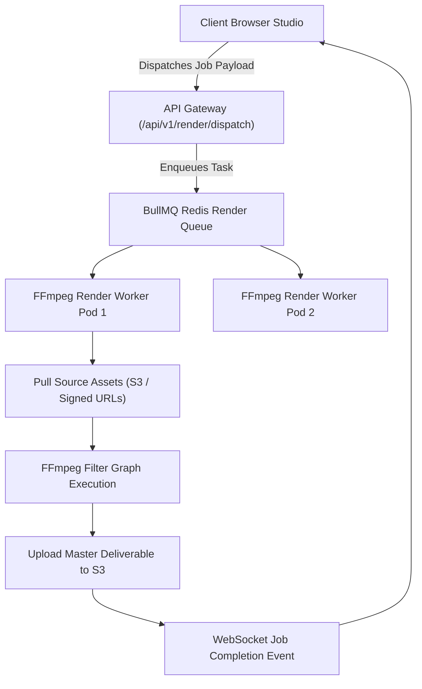

# FRAMEFLOW Architecture Specification: Cloud Rendering & Export Pipeline
**Document ID:** `ARCH-CLD-001`  
**Classification:** Distributed Cloud Infrastructure & Transcoding  
**Version:** 2.0  

---

## 1. Asynchronous Cloud Export Flow

---

## 2. Rendering Job Payload Schema
A client render request transmits the sequence composition graph as a normalized JSON manifest:
- **Output Spec:** Container (`mp4`, `mov`, `mkv`), Codec (`libx264`, `libx265`, `prores_ks`), Resolution (`1920x1080`), Bitrate (`15 Mbps`), Audio (`aac`, `pcm_s24le`).
- **Timeline Graph:** Array of tracks, clip ranges, time offsets, crop coordinates, audio volume nodes, and transition shader definitions.
- **Worker Execution:** The worker translates the composition graph into a complex multi-input FFmpeg filter graph (`-filter_complex`), renders the master file in parallel, and returns a secure signed download link.
