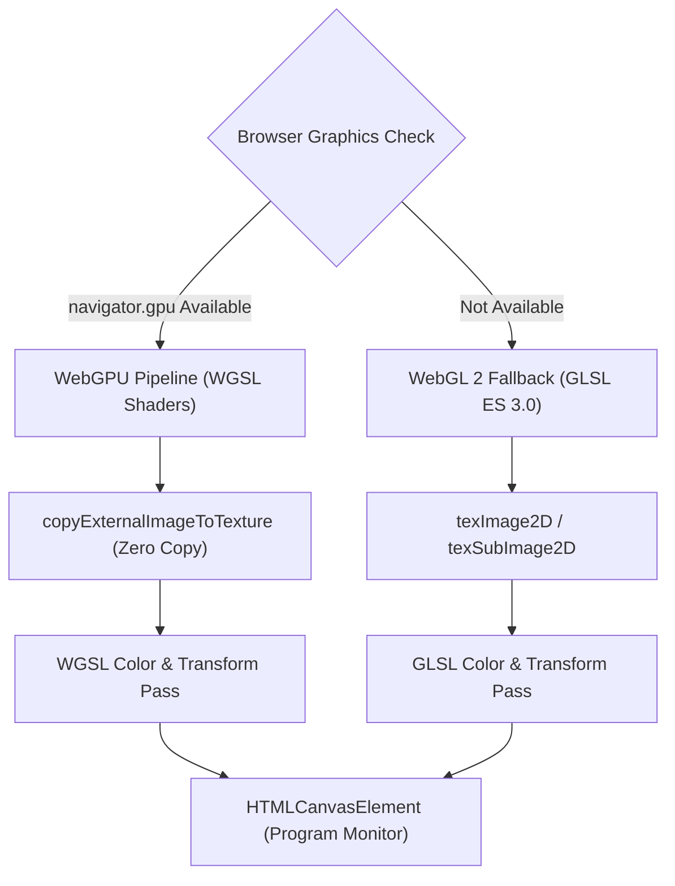

# FRAMEFLOW Architecture Specification: GPU Rendering & Compositing
**Document ID:** `ARCH-GPU-001`  
**Classification:** Real-Time Shaders & Graphics Compositing  
**Version:** 2.0  

---

## 1. Dual-Backend Architecture: WebGPU with WebGL 2 Fallback

---

## 2. WebGPU Pipeline Specifications
- **Texture Upload:** Uses `device.queue.copyExternalImageToTexture()` to copy `VideoFrame`, `ImageBitmap`, or `HTMLVideoElement` directly into GPU memory without round-tripping through CPU RAM.
- **Shader Language:** Standard WGSL (WebGPU Shading Language).
- **Color Pipeline Math:**
  - Evaluated in linear color space with 32-bit floating point precision (`rgba32float` or `rgba16float`).
  - Exposure: $C_{out} = C_{in} \times 2^{EV}$
  - Contrast: $C_{out} = (C_{in} - 0.18) \times Contrast + 0.18$
  - Saturation: Matrix luminance dot product with Rec.709 coefficients ($[0.2126, 0.7152, 0.0722]$).
- **Graceful Device Loss Handling:**
  - Listens to `device.lost.then(info => ...)`.
  - Automatically re-initializes pipeline resources or transitions cleanly to the WebGL 2 fallback pipeline without crashing the user's active timeline session.
