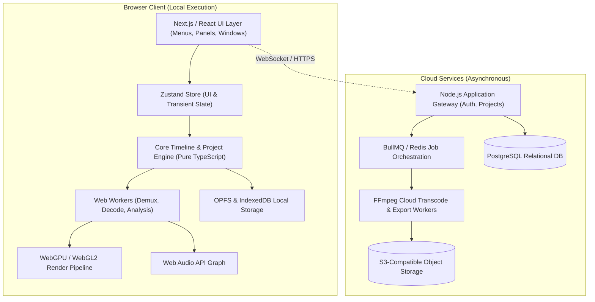

# FRAMEFLOW Architecture Specification: Web Platform Architecture
**Document ID:** `ARCH-WEB-001`  
**Classification:** Core System Architecture  
**Version:** 2.0  

---

## 1. System Topology & Tier Separation

FRAMEFLOW divides its application runtime into three decoupled tiers:

---

## 2. Decoupled Core Philosophy
The core editing and timeline engine (`@frameflow/timeline-engine`, `@frameflow/project-engine`) contains **zero React or UI framework dependencies**.
- The timeline operates as a deterministic state machine.
- Frame calculations, sub-frame audio math, cut point intersections, and undo/redo histories run in pure TypeScript.
- The UI layer (React + Zustand) subscribes to engine events via a lightweight pub/sub observer pattern.
- High-frequency operations (such as playhead scrubbing at 60fps) update Canvas 2D / WebGPU renderers directly without re-rendering React component trees.

---

## 3. Worker-Based Multiprocessing
To guarantee that the UI main thread never drops frames or stutters during user interaction:
- **Demux Worker:** Parses container atoms/boxes (MP4, WebM, MOV) and delivers encoded chunks.
- **Decode Worker:** Dispatches `VideoDecoder` and `AudioDecoder` requests to hardware accelerators.
- **Waveform Worker:** Downsamples multi-channel audio data and generates SVG/Canvas peak vectors.
- **Storage Worker:** Performs synchronous file I/O to the Origin Private File System via `FileSystemSyncAccessHandle`.
