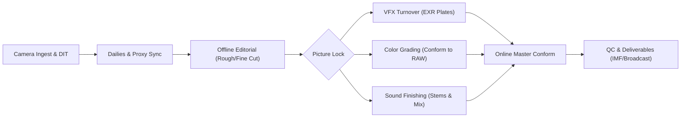

# FRAMEFLOW — Professional Post-Production Workflow Analysis
**Document ID:** `RES-WRK-001`  
**Classification:** Studio Pipeline & Industry Practice Analysis  
**Version:** 2.0  
**Scope:** Commercial, Episodic, Feature, and Digital Production Pipelines  

---

## 1. The Standard Hollywood & Broadcast Production Pipeline

Modern post-production is not a monolithic single-person activity; it is a multi-stage, collaborative relay race spanning specialized craftspeople. For FRAMEFLOW to succeed as a professional competitor, its data models, project schemas, and interchange formats must seamlessly integrate with this pipeline.

---

## 2. Stage-by-Stage Operational Deep Dive

### Stage 1: Ingest, Verification & Backup (DIT / Media Manager)
- **Industry Practice:** Camera cards (CFexpress, RED Mini-Mag, SD) are offloaded using checksum-verified tools (Silverstack, ShotPut Pro) creating dual identical backups to local NVMe RAID and LTO tape. Checksums verified via MD5, SHA-256, or xxHash64.
- **Data Extracted:** Timecode track, reel name, camera roll, lens metadata, ISO, shutter angle, color temperature, and embedded audio tracks.
- **FRAMEFLOW Integration:** Local file ingest reads source metadata directly through WebAssembly container demuxers (Mediabunny / MP4Box) without uploading raw gigabytes to cloud servers.

### Stage 2: Dailies, Sync & Proxy Generation (Assistant Editor)
- **Industry Practice:** 4K/8K RAW footage (ARRIRAW, REDCODE, BRAW, Sony X-OCN) is too bandwidth-intensive for responsive timeline scrubbing. Assistant Editors generate lightweight editing proxies (Apple ProRes 422 Proxy or Avid DNxHR LB at 1080p). Dual-system production sound (multi-track Polyphonic WAV from Sound Devices) is synchronized to video via matching timecode or waveform cross-correlation.
- **FRAMEFLOW Integration:** Automatic client-side proxy generation via WebCodecs into the browser OPFS (Origin Private File System). Playhead scrubbing defaults to low-latency proxies with zero network latency.

### Stage 3: Offline Editorial (Lead Video Editor)
- **Industry Practice:** The creative core of storytelling. The editor organizes footage into hierarchical Bins, creates script sequences, selects selects, assemblies, rough cuts, and fine cuts. Heavy use of keyboard shortcuts (`J-K-L` shuttle, `Q-W` ripple trims, match frame).
- **Milestone:** **Picture Lock** — the definitive creative sign-off where no further frame cuts, duration shifts, or timing changes are permitted.
- **FRAMEFLOW Integration:** Uncompromised keyboard-centric cutting speed, deterministic multi-track timeline, sub-frame trimming, and instant snapshot versioning.

### Stage 4: Turnover & Conform (Finishing Editor / Assistant Editor)
- **Industry Practice:** Once picture is locked, editorial cuts must be handed off to specialized departments (VFX, Color, Sound). The timeline is exported as an interchange document: **OpenTimelineIO (OTIO)**, **FCPXML**, **EDL**, or **AAF**. The finishing editor relinks the proxy cut back to the camera original RAW files.
- **FRAMEFLOW Integration:** Native OTIO and FCPXML import/export capabilities, paired with an automated proxy-to-original relinking matrix.

### Stage 5: Visual Effects (VFX Department)
- **Industry Practice:** Shots requiring rotoscoping, CGI, or green-screen compositing are exported as 16-bit or 32-bit float OpenEXR image sequences with standard frame handles (typically +8 to +12 frames before and after the cut for transition flexibility). Work is performed in Nuke or Houdini in linear ACEScg color space.
- **FRAMEFLOW Integration:** Frame handle preservation on export, WebGPU shader node compositing for in-editor quick comps, and lossless frame sequence export.

### Stage 6: Color Grading & Finishing (Colorist)
- **Industry Practice:** Colorists grade original camera RAW files in DaVinci Resolve or Baselight using calibrated reference monitors (Rec.709 2.4 Gamma for SDR, Rec.2020 PQ/HLG for HDR). Color spaces are normalized via ACES or DaVinci RCM.
- **FRAMEFLOW Integration:** Real-time 32-bit floating-point WebGPU color processing pipeline with primary 3-way color wheels (Lift/Gamma/Gain), custom Bezier spline curves, 3D LUT import, and professional video scopes (Parade, Waveform, Vectorscope).

### Stage 7: Sound Design, Foley, ADR & Mixing (Sound Team)
- **Industry Practice:** Dialogue tracks are cleaned using spectral repair (iZotope RX); Foley, sound effects, and musical score are arranged into hundreds of tracks in Pro Tools. Output is mixed into standardized broadcast stems:
  - **Dialogue Stem (DX)**
  - **Music Stem (MX)**
  - **Effects & Foley Stem (FX)**
  - **Composite Master Print (Stereo & 5.1/7.1 Surround)**
  - Loudness adheres strictly to **ITU-R BS.1770-4 / EBU R128 (-23 LUFS ±0.5)** or **ATSC A/85 (-24 LUFS)**.
- **FRAMEFLOW Integration:** Web Audio API multichannel routing, audio roles/stems architecture, integrated 4-band EQ, compressor, and real-time True-Peak / Integrated LUFS loudness metering.

### Stage 8: Quality Control (QC) & Multi-Platform Mastering
- **Industry Practice:** Automated and manual QC checks for black frames, flash frames, audio clipping, phase issues, caption sync, and legal broadcast video levels (16–235 Studio Swing vs 0–255 Full Swing). Final deliverables packaged into Apple ProRes 422 HQ, Avid DNxHR HQX, Interoperable Master Format (IMF packages for Netflix/Amazon), or H.264/HEVC web deliverables.
- **FRAMEFLOW Integration:** Asynchronous Cloud FFmpeg rendering workers generating bit-exact broadcast and web masters with integrated QC telemetry logs.

---

## 3. Role-Based Feature Requirements Matrix

| Professional Role | Primary Operational Goals | Critical FRAMEFLOW Capabilities Required |
| :--- | :--- | :--- |
| **Ingest Operator / DIT** | Verify card integrity, ingest media without corruption, extract camera metadata. | Fast browser demuxing, metadata viewer, timecode extraction, file integrity checking. |
| **Assistant Editor** | Organize bins, synchronize multi-track audio to video, generate proxies, prep sequences. | Waveform-based audio sync, OPFS background proxy creation, smart bin tagging. |
| **Lead Video Editor** | High-velocity narrative storytelling, pacing, invisible cuts, rapid auditioning. | Sub-frame multi-track trimming, keyboard shortcut remapping, dual-monitor JKL transport. |
| **Motion Designer** | Kinetic typography, lower-thirds, shape animation, dynamic logo reveals. | Inline Graph Editor, Bezier keyframe curve handles, typography styling, alpha channel blending. |
| **Colorist** | Shot-to-shot matching, look creation, highlight recovery, skin tone protection. | WebGPU 32-bit float color engine, RGB parade, vectorscope, 3-way color wheels, 3D LUT support. |
| **Sound Designer** | Voice clarity, noise reduction, music ducking, stem routing, loudness compliance. | Web Audio DSP graph, multi-bus audio mixer, automated ducking, integrated LUFS loudness meter. |
| **Conform / Finishing Artist** | Reassemble locked cut against original camera files, verify frame-accuracy, finalize titles. | OTIO/XML interchange, proxy-to-RAW relinking, sub-frame slip/slide adjustments. |
